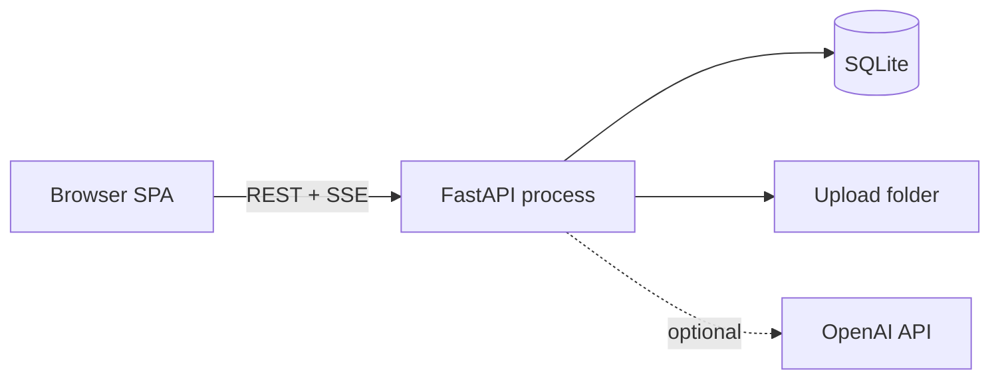

# DocChat architecture

DocChat is a **local-first** document Q&A stack: a React SPA talks to a single FastAPI process that owns SQLite, file storage, ingestion, retrieval, and chat generation. OpenAI is an optional external dependency for embeddings and answers.

## System context

## Backend layers

Dependencies flow **inward**: routes → services → infrastructure → core. Nothing in `core/` or `infrastructure/` imports from `api/` or `services/`.

| Layer | Path | Responsibility |
| --- | --- | --- |
| **Assembly** | `main.py`, `runtime.py`, `run.py` | Create `AppContext`, wire middleware, static UI, exception handlers |
| **HTTP** | `api/routes/`, `api/schemas.py`, `api/dependencies.py`, `api/router.py` | Auth, validation, status codes, SSE; no business rules |
| **Application** | `services/` | Parsing, chunking, ingestion jobs, RAG retrieval, answer generation |
| **Infrastructure** | `infrastructure/` | SQLite repository, OpenAI HTTP client |
| **Core** | `core/` | YAML config, password/JWT helpers, structured logging |

### `AppContext` (composition root)

`runtime.build_context()` is the only place that constructs shared singletons for a process lifetime:

- `Config` from `config.yaml`
- `Database` (schema init on startup)
- `OpenAIClient`, `RagService`, `IngestionService`
- Resolved paths for uploads and built frontend static files

Route handlers receive `AppContext` via `get_context` and never construct services themselves.

### Request lifecycle

1. Middleware assigns `request_id` and logs latency (no document text in logs).
2. `current_user` validates bearer token and loads the user from SQLite.
3. Route delegates to `services` or `database` with **user-scoped** IDs.
4. Background tasks (e.g. ingestion) reuse the same `IngestionService` instance from context.

### API surface grouping

| Module | Prefix / paths | Domain |
| --- | --- | --- |
| `health.py` | `/health`, `/ready`, `/api/settings` | Ops and local settings |
| `auth.py` | `/api/auth/*` | Register, login, tokens |
| `documents.py` | `/api/documents/*` | Upload, list, delete, reindex |
| `conversations.py` | `/api/documents/{id}/conversations`, `/api/conversations/*` | Threads per document |
| `messages.py` | `/api/conversations/{id}/messages/*` | History, streaming chat, feedback |

Interactive OpenAPI docs reflect route `tags` for navigation.

## Frontend layout

The UI is a **feature-oriented** tree under `frontend/src/`:

| Area | Path | Role |
| --- | --- | --- |
| **Shell** | `components/layout/` | Workspace, sidebars, top bar |
| **Auth** | `components/auth/`, `contexts/AuthContext.tsx` | Login, register, protected shell |
| **Documents** | `components/documents/` | Upload, list, status badges |
| **Chat** | `components/chat/` | Messages, composer, streaming |
| **Sources** | `components/sources/` | Citation panel |
| **Settings** | `components/settings/` | Local API key (never echoed from server) |
| **Design system** | `components/ui/` | shadcn-style primitives |
| **Shared** | `components/common/` | Loading, errors, brand |
| **Data** | `lib/api.ts`, `lib/storage.ts`, `types/api.ts` | Typed client aligned with FastAPI schemas |
| **Hooks** | `hooks/` | Reusable UI logic (e.g. debounce) |

`main.tsx` owns global providers (React Query, auth, tooltips). `App.tsx` stays a thin composition root.

### Dev vs production

- **Development**: Vite on port 5173 proxies API traffic to FastAPI on 8000.
- **Production**: `npm run build` output in `frontend/dist` is served by FastAPI at `/` and `/static`.

## Configuration

All runtime settings live in **`config.yaml`** (copy from `config.example.yaml`). There is no `.env` split: one file keeps local MVP operation predictable. Secrets (OpenAI key, JWT secret) belong in that file and are gitignored.

## Testing strategy

| Suite | Location | Focus |
| --- | --- | --- |
| Python | `tests/` | Security, DB isolation, chunking, upload-to-chat without live OpenAI |
| Frontend | `frontend/src/**/*.test.*` | Utilities and critical UI states |

## Extension points (without rewriting the MVP)

- **Durable jobs**: replace FastAPI `BackgroundTasks` with a queue worker; keep `IngestionService` API stable.
- **Vector store**: swap embedding storage inside `infrastructure/database.py` / `RagService` while keeping route contracts.
- **Multi-tenant hosting**: externalize secrets, add TLS termination, and use object storage instead of `data/uploads/`.

## Maintainer

**Ajxdevx** — [Ajxfuture@gmail.com](mailto:Ajxfuture@gmail.com)
